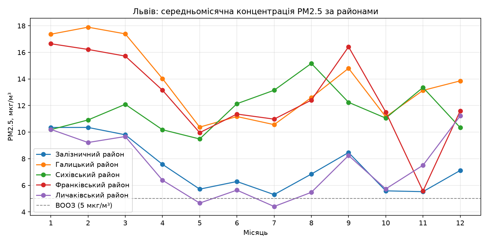
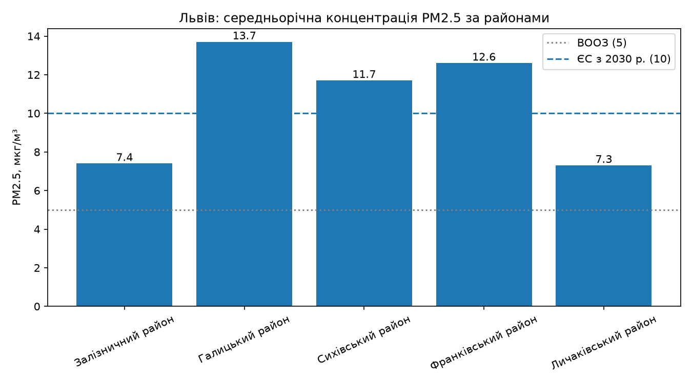
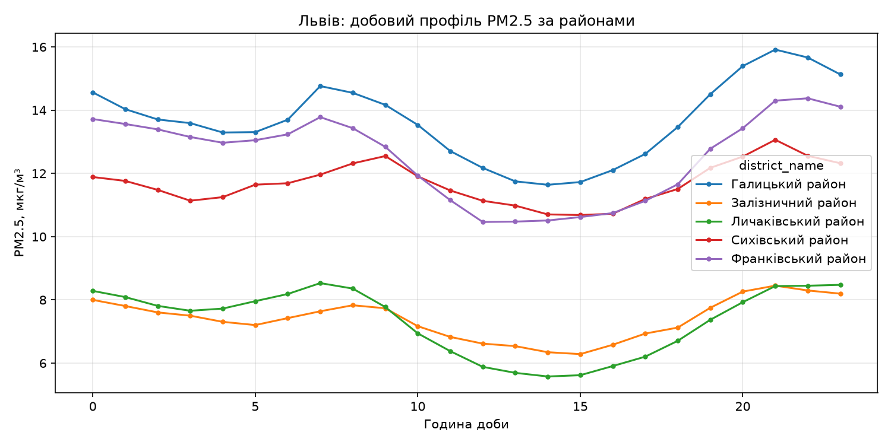
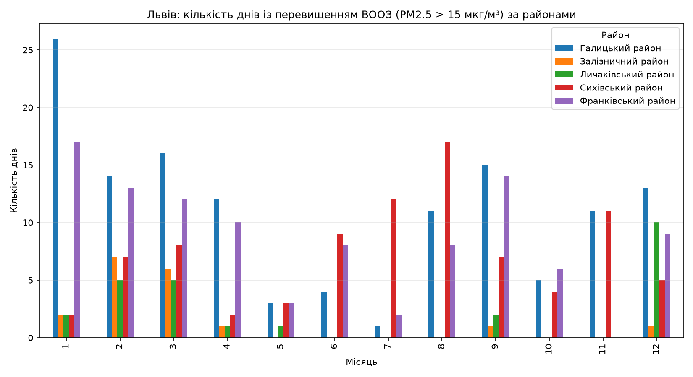

# Практична робота № 4. Відкриті міські дані та індикатори сталості

## Як запустити

```bash
python -m venv .venv
.venv\Scripts\Activate.ps1
pip install -r requirements.txt
python scripts/download_data.py --years 2023 --districts
jupyter notebook notebooks/pr4_lviv_districts_pm25.ipynb
```

## 1. Варіант і питання дослідження

**Варіант 4. Львів, 2023 рік.**

Порівняти Залізничний, Галицький, Сихівський, Франківський та Личаківський райони Львова: де найбільше днів із перевищенням настанови ВООЗ для PM2.5 (> 15 мкг/м³) та в які місяці вони трапляються найчастіше.

## 2. Дані

Використано відкриті дані SaveDnipro з data.gov.ua, ліцензія CC BY.

Файли:
- `saveecobot_city_districts.csv`;
- `saveecobot_city_districts_pm25_and_aqi_pm25_2023.csv`.

## 3. Якість даних

До очищення — **47 595 рядків**, після очищення — **47 380**. Виявлено 215 пропусків PM2.5, дублікатів та неможливих значень не знайдено.

Повнота даних для основних п’яти районів перевищує **97 %**. У Шевченківському районі вона становить лише близько **44 %**, тому його результат не використовувався для основного порівняння.

## 4. Індикатори

| Район | PM2.5, мкг/м³ | Діб >15 | Діб >25 | Повнота, % | Рівень ВООЗ |
|---|---:|---:|---:|---:|---|
| Галицький | 13,7 | 131 | 16 | 100,0 | IT-3 |
| Залізничний | 7,4 | 18 | 1 | 100,0 | IT-4 |
| Личаківський | 7,3 | 26 | 2 | 99,2 | IT-4 |
| Сихівський | 11,7 | 87 | 5 | 99,5 | IT-3 |
| Франківський | 12,6 | 102 | 18 | 97,8 | IT-3 |

Ручна перевірка для Франківського району: 357 / 365 × 100 % = **97,8 %**. Середньорічне значення 12,6 мкг/м³ відповідає рівню IT-3 та приблизно у **2,5 раза** перевищує настанову ВООЗ 5 мкг/м³.

## 5. Графіки







## 6. Творча частина

Гіпотеза: кількість днів із перевищенням ВООЗ відрізняється між районами Львова.

Найбільше перевищень отримано у:
- Галицькому районі — **131 день**;
- Франківському — **102**;
- Сихівському — **87**;
- Личаківському — **26**;
- Залізничному — **18**.

У Галицькому районі найбільше перевищень було в **січні — 26 днів**. Отже, гіпотеза підтвердилася.



## 7. Висновки й обмеження

Найвища середньорічна концентрація PM2.5 зафіксована у Галицькому районі — **13,7 мкг/м³**, найнижча — у Личаківському — **7,3 мкг/м³**.

Основні обмеження: використання недорогих сенсорів громадського моніторингу, зміна кількості та розташування сенсорів, місцевий час із переходом на літній час та можливі пропуски через технічні проблеми й відключення електроенергії.

## 8. Журнал використання ШІ

| Крок | Що зроблено за допомогою ШІ | Що перевірено або виправлено |
|---|---|---|
| Адаптація | Код перероблено для районів Львова | `city_id` замінено на `district_id` |
| Якість даних | Розрахунок повноти | Виправлено розрахунок на повний 2023 рік |
| Графіки | Код візуалізації | Виправлено помилку `groupby` |
| Творча частина | Розрахунок перевищень ВООЗ | Перевірено умову `PM2.5 > 15` |