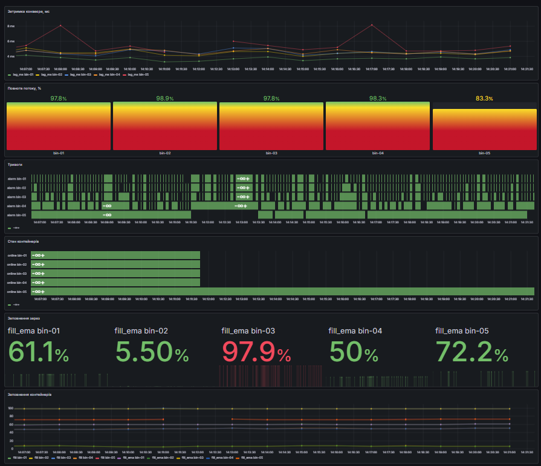
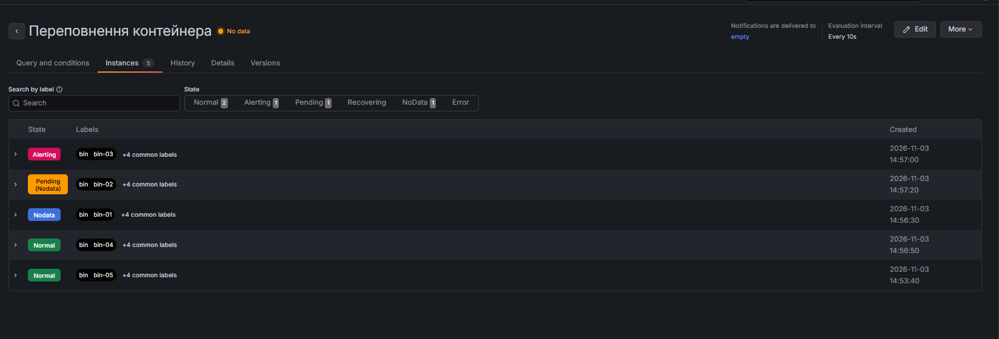

# ПР5. IoT-конвеєр міської інфраструктури

**Студент:** Ликова Вікторія, М КН 2026-1  
**Варіант:** № 4 — Контейнери твердих побутових відходів  
**Дата:** 03.11.2026

## 1. Архітектура

У практичній роботі створено IoT-конвеєр для моніторингу п’яти контейнерів відходів:

**Пристрої → MQTT (Mosquitto) → Node-RED → PostgreSQL → Grafana**

Симулятор генерує телеметрію контейнерів `bin-01`–`bin-05` кожні 5 секунд. MQTT-брокер Mosquitto приймає повідомлення, Node-RED перевіряє та обробляє їх, PostgreSQL зберігає результати, а Grafana використовується для візуалізації та контролю стану системи.

| Сервіс | Образ | Порт | Призначення |
|---|---|---:|---|
| Mosquitto | `eclipse-mosquitto:2.0.22` | 1883 | MQTT-брокер |
| PostgreSQL | `postgres:16` | 5433 | зберігання телеметрії |
| Node-RED | `pr5-nodered:4.1` | 1880 | перевірка та обробка потоку |
| Grafana | `grafana/grafana:12.4` | 3000 | візуалізація даних |

Усі сервіси запускаються за допомогою Docker Compose. Файл `.env` містить паролі та не додається до Git.

## 2. Модель даних

### MQTT-теми

Для варіанта 4 використовується префікс:

```text
kharkiv/waste/<id>/
```

Основні теми:

| Тема | Призначення |
|---|---|
| `kharkiv/waste/<id>/telemetry` | телеметрія контейнера |
| `kharkiv/waste/<id>/status` | стан `online/offline` |
| `kharkiv/waste/<id>/alarm` | стан тривоги |

Node-RED підписується на:

```text
kharkiv/waste/+/telemetry
kharkiv/waste/+/status
```

Приклад телеметрії:

```json
{
  "ts": 1793699302722,
  "d": 68.7,
  "h": 120.0
}
```

де `ts` — час вимірювання, `d` — відстань від датчика до відходів у сантиметрах, `h` — висота контейнера. У роботі висота контейнера становить 120 см.

Для телеметрії використовується QoS 1. Повідомлення стану та тривоги публікуються з прапорцем `retain`, щоб новий підписник одразу отримував останній актуальний стан.

### Навантаження

У системі працюють 5 контейнерів, кожен передає повідомлення раз на 5 секунд.

Кількість повідомлень за годину:

```text
M = n × 3600 / Δt
M = 5 × 3600 / 5 = 3600 повідомлень/год
```

Якщо одне MQTT-повідомлення разом із темою та службовими даними займає приблизно 90 байтів, добовий обсяг становить:

```text
V = n × 86400 / Δt × b
V = 5 × 86400 / 5 × 90
V ≈ 7 776 000 байтів ≈ 7,8 МБ/добу
```

Отже, навіть невелика мережа генерує постійний потік даних, а зі збільшенням кількості пристроїв навантаження зростатиме майже лінійно.

### PostgreSQL

Основна таблиця `waste` зберігає результати вимірювань:

| Поле | Зміст |
|---|---|
| `ts` | час вимірювання |
| `bin` | ідентифікатор контейнера |
| `d` | відстань до відходів, см |
| `h` | висота контейнера, см |
| `fill` | розраховане заповнення, % |
| `fill_ema` | згладжене заповнення, % |
| `rate` | швидкість зміни заповнення, %/год |
| `t100` | прогноз часу до 100 % |
| `alarm` | стан тривоги 0/1 |
| `lag_ms` | затримка конвеєра, мс |

Первинний ключ таблиці — пара `(bin, ts)`. Це не дозволяє записати один і той самий вимір двічі.

Для станів контейнерів використовується таблиця `bin_status` з полями часу, ідентифікатора контейнера та стану `online`.

Запис телеметрії виконується параметризованим запитом:

```sql
INSERT INTO waste (
    ts, bin, d, h, fill, fill_ema,
    rate, t100, alarm, lag_ms
)
VALUES (
    to_timestamp($1 / 1000.0),
    $2, $3, $4, $5, $6, $7, $8, $9, $10
)
ON CONFLICT (bin, ts) DO NOTHING;
```

`ON CONFLICT DO NOTHING` захищає базу від дублікатів при можливій повторній доставці MQTT-повідомлення з QoS 1.

## 3. Обробка потоку

Після отримання телеметрії Node-RED перевіряє коректність даних. Для варіанта 4 допустима відстань `d` становить від 0 до 150 см, а висота контейнера `H = 120 см`.

Заповнення контейнера визначається за формулою:

```text
F = (H - d) / H × 100 %
```

де `F` — заповнення контейнера, `H` — висота контейнера, `d` — відстань від датчика до відходів.

### Ручна перевірка

Для `bin-01` при `d = 63,7 см`:

```text
F = (120 - 63,7) / 120 × 100 ≈ 46,9 %
```

Для `bin-03` при `d = 10,4 см`:

```text
F = (120 - 10,4) / 120 × 100 ≈ 91,3 %
```

Для `bin-04` при `d = 73,5 см`:

```text
F = (120 - 73,5) / 120 × 100 ≈ 38,8 %
```

Отримані вручну значення збігаються з результатами Node-RED.

Для зменшення випадкових коливань використовується експоненційне згладжування:

```text
EMA(t) = α × F(t) + (1 - α) × EMA(t-1)
```

У роботі використано:

```text
α = 0,2
```

Таке значення згладжує короткочасні коливання датчика, але при цьому дозволяє системі реагувати на зміни заповнення.

Швидкість заповнення `r` визначається за зміною згладженого значення у часі.

Прогноз часу до повного заповнення:

```text
t100 = (100 - F) / r
```

Наприклад, якщо згладжене заповнення становить `46,6 %`, а швидкість заповнення `52,9 %/год`:

```text
t100 = (100 - 46,6) / 52,9 ≈ 1,0 год
```

Прогноз розраховується лише тоді, коли швидкість заповнення додатна.

### Тривога з гістерезисом

Для контейнерів використано два пороги:

```text
ON = 80 %
OFF = 30 %
```

Якщо `fill_ema ≥ 80 %`, тривога вмикається. Після вивезення відходів вона вимикається лише тоді, коли `fill_ema ≤ 30 %`.

Гістерезис запобігає постійному перемиканню тривоги, коли значення знаходиться поблизу одного порога.

## 4. Дашборд Grafana

Створено дашборд **«ПР5 — Контейнери відходів»**.

Файл конфігурації:

```text
grafana/dashboards/pr5.json
```

Знімок дашборду:



На дашборді створено 6 панелей.

### Панель 1. Заповнення контейнерів

Показує поточне та згладжене заповнення контейнерів.

```sql
SELECT
    $__timeGroupAlias(ts, $__interval),
    bin,
    avg(fill) AS fill,
    avg(fill_ema) AS fill_ema
FROM waste
WHERE $__timeFilter(ts)
GROUP BY 1, 2
ORDER BY 1;
```

### Панель 2. Заповнення зараз

Показує актуальне згладжене значення `fill_ema` для кожного контейнера.

```sql
SELECT
    ts AS "time",
    bin,
    fill_ema
FROM waste
WHERE $__timeFilter(ts)
ORDER BY 1;
```

### Панель 3. Стан контейнерів

Використовується тип `State timeline`. Значення `1` відповідає стану `online`, `0` — `offline`.

```sql
(
    SELECT DISTINCT ON (bin)
        $__timeFrom()::timestamptz AS "time",
        bin,
        online
    FROM bin_status
    WHERE ts < $__timeFrom()
    ORDER BY bin, ts DESC
)

UNION ALL

SELECT
    ts AS "time",
    bin,
    online
FROM bin_status
WHERE $__timeFilter(ts)

ORDER BY 1;
```

### Панель 4. Тривоги

Відображає стан тривоги для кожного контейнера.

```sql
SELECT
    ts AS "time",
    bin,
    alarm
FROM waste
WHERE $__timeFilter(ts)
ORDER BY 1;
```

Значення `0` означає нормальний стан, `1` — тривогу.

### Панель 5. Повнота потоку

Повнота визначається як частка фактично отриманих повідомлень від очікуваної кількості.

```sql
SELECT
    max(ts) AS "time",
    bin,
    100.0 * count(*) * 5
      / ($__unixEpochTo() - $__unixEpochFrom())
      AS completeness
FROM waste
WHERE $__timeFilter(ts)
GROUP BY bin
ORDER BY 1;
```

Пороги в Grafana:

```text
< 80 % — червоний
80–95 % — жовтий
≥ 95 % — зелений
```

Під час роботи більшість контейнерів мали повноту близько 95–98 %. Для `bin-05` після сценарію знеструмлення повнота була нижчою.

### Панель 6. Затримка конвеєра

```sql
SELECT
    $__timeGroupAlias(ts, $__interval),
    bin,
    avg(lag_ms) AS lag_ms
FROM waste
WHERE $__timeFilter(ts)
GROUP BY 1, 2
ORDER BY 1;
```

У звичайному режимі затримка становила приблизно 4–9 мс.

## 5. Експеримент зі стійкістю

Було проведено три експерименти.

| Сценарій | Що зробили | Що побачили | Результат для даних |
|---|---|---|---|
| Знеструмлення `bin-05` | Контейнер перестав передавати повідомлення | Пристрій перейшов у `offline` приблизно через 16 с, після відновлення знову став `online` | За час знеструмлення телеметрія не надходила |
| Зупинка Node-RED на 60 с | Зупинено контейнер Node-RED | MQTT-брокер накопичив повідомлення, після запуску вони були передані далі; затримка тимчасово зросла приблизно до 28 с | Дані не втрачено |
| Зупинка PostgreSQL на 60 с | Зупинено PostgreSQL | У Node-RED з’явилися помилки запису, на графіку виник розрив | Частина даних втрачена |

Експеримент із Node-RED показав перевагу постійної MQTT-сесії: брокер може тимчасово накопичувати повідомлення для відключеного споживача.

Між Node-RED і PostgreSQL окремого буфера немає. Тому під час недоступності PostgreSQL повідомлення, які не вдалося записати, втрачаються.

Для усунення цієї проблеми можна використати підхід **store-and-forward**: тимчасово зберігати невідправлені повідомлення у черзі або локальному файлі та повторювати запис після відновлення PostgreSQL.

## 6. Творче питання варіанта 4

**Як прогноз `t100` дозволяє будувати маршрут сміттєвоза, а не об’їжджати всі контейнери? Оцініть економію пробігу для вашої мережі.**

Прогноз `t100` показує, через скільки часу кожен контейнер може бути повністю заповнений. Завдяки цьому сміттєвоз може їхати тільки до контейнерів, які найближчим часом потребуватимуть вивезення, а не об’їжджати всю мережу.

У моїй моделі є 5 контейнерів. Наприклад, якщо за прогнозом найближчим часом потрібно обслужити тільки `bin-03` і `bin-05`, машина відвідає 2 контейнери замість 5.

За спрощеного припущення, що відстань до кожного контейнера однакова:

```text
Економія = (5 - 2) / 5 × 100 % = 60 %
```

Отже, теоретична економія пробігу становить приблизно **60 %**.

У реальній системі для точного розрахунку потрібно враховувати координати контейнерів, дорожню мережу, відстані між ними, місткість сміттєвоза та прогноз `t100` кожного контейнера.

## 7. Висновки й обмеження

У практичній роботі №5 я створила IoT-конвеєр для моніторингу п’яти контейнерів відходів за схемою MQTT → Node-RED → PostgreSQL → Grafana.

Телеметрія надходила кожні 5 секунд. Для контейнерів розраховувалося поточне та згладжене заповнення, швидкість зміни заповнення, прогноз `t100` та стан тривоги. Тривога вмикалася при перевищенні 80 % і вимикалася після зменшення заповнення до 30 %.

У нормальному режимі затримка конвеєра становила приблизно 4–9 мс. Під час знеструмлення `bin-05` стан `offline` було зафіксовано приблизно через 16 с. Зупинка Node-RED не призвела до втрати накопичених MQTT-повідомлень, але затримка тимчасово зросла приблизно до 28 с. При зупинці PostgreSQL виникли помилки запису та частина даних була втрачена.

Основними обмеженнями роботи є використання симулятора замість реальних датчиків, відсутність окремого буфера між Node-RED і PostgreSQL та відсутність резервування сервісів.

## 8. Використання ШІ

Під час виконання практичної роботи використовувався ChatGPT.

ШІ використовувався для пояснення налаштувань Docker Compose, MQTT, Node-RED, PostgreSQL і Grafana, адаптації прикладу до варіанта 4, перевірки SQL-запитів та пошуку причин помилок.

Під час роботи за допомогою перевірки були знайдені та виправлені проблеми з підписками MQTT, параметрами запису PostgreSQL, назвами таблиць, відображенням часових рядів у Grafana та налаштуванням правила тривоги.

Результати перевірялися вручну: контролювалися MQTT-повідомлення, записи в PostgreSQL, значення `fill`, `fill_ema`, робота дашборду, стани `online/offline` та результати експериментів зі стійкістю.

## 9. Додаткове завдання

У Grafana створено додаткове правило тривоги для контролю переповнення контейнерів.

Правило використовує останнє згладжене значення `fill_ema`:

```text
Reduce: Last
Threshold: fill_ema > 80 %
Pending period: 1 minute
Evaluation interval: 10 seconds
```

Під час перевірки контейнер `bin-03` мав `fill_ema` близько **97,8 %**, тому Grafana перевела його у стан `Alerting`. Інші контейнери зі значеннями нижче 80 % залишилися у стані `Normal`.



Для оперативного виявлення подій краще використовувати Node-RED, оскільки він працює безпосередньо з потоком даних і може реагувати ще до запису в базу. Grafana зручніша для контролю, візуалізації історичних даних та створення додаткових правил на основі вже збереженої інформації.