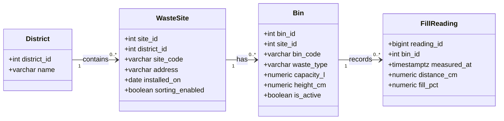

# ПР7. Проєктування та супровід бази міських даних у PostgreSQL

**Студент:** Ликова Вікторія, група М КН 2026-1  
**Варіант:** № 4 - Контейнери відходів  
**Дата:** 28.11.2026  
**Середовище:** PostgreSQL 16, pgAdmin 4 (версія 9), Windows, Docker Desktop

## 1. Розбір прикладу (кроки 1–8)

У першій частині практичної роботи було налаштовано середовище PostgreSQL за допомогою Docker Desktop. Для роботи з базою даних використано pgAdmin 4.

Після підключення до бази даних `cityair` було виконано міграції V1–V4 та завантажено тестові дані. У схемі `airq` перевірено наявність таблиць і зв'язків між ними.

Для аналізу даних виконано SQL-запити, які дозволили визначити середні концентрації забруднювальних речовин, порівняти показники між районами, дослідити зміни за часом та перевірити ефективність індексів.

### Результати перевірки

| Перевірка | Результат |
|---|---|
| Кількість рядків у `measurement` | 105 120 (за результатом завантаження) |
| Район із найбільшим середнім PM2.5 у листопаді | Холодногірський - 27,7 мкг/м³ |
| Час виконання q03 до V4 | 8,064 мс, Seq Scan |
| Час виконання q03 після V4 | 0,247 мс, Bitmap Index Scan |
| Прискорення | 32,6 раза |
| Розмір таблиці `measurement` | 7864 КБ |
| Розмір B-tree | 4192 КБ |
| Розмір BRIN | 24 КБ |
| Зважене середнє PM2.5 | 16,9 мкг/м³ |
| Просте середнє PM2.5 | 18,0 мкг/м³ |

Після створення індексів запит почав виконуватися значно швидше. Час зменшився з 8,064 до 0,247 мс, тобто приблизно у 32,6 раза. Індекс BRIN займає значно менше місця, ніж B-tree, оскільки зберігає інформацію про діапазони значень, а не окремі записи.

Також було виконано запити з віконними функціями, пошуком епізодів забруднення та матеріалізованим поданням. У результаті виявлено 31 епізод перевищення PM2.5, а матеріалізоване подання містить 2920 записів.

На основі даних SaveEcoBot проаналізовано показники Києва та Харкова за 2021–2023 роки. У 2023 році середньорічна концентрація PM2.5 у Києві становила 10,7 мкг/м³, а в Харкові - 5,8 мкг/м³.

## 2. Предметна область варіанта

### 2.1. Опис застосування

Для свого варіанта я розглядаю систему, яка допомагає контролювати заповнення сміттєвих контейнерів у місті.

Основна проблема полягає в тому, що контейнери заповнюються нерівномірно. В одному районі вони можуть бути майже порожніми, а в іншому вже переповненими. Через це сміттєвози іноді приїжджають туди, де вивезення ще не потрібне, або не встигають забрати відходи з переповнених контейнерів.

Запропонована база даних повинна зберігати інформацію про місця розташування контейнерів, їхні характеристики та показники заповнення. Дані про рівень заповнення можуть надходити від датчиків, установлених на контейнерах.

Основними користувачами системи будуть працівники комунального підприємства, диспетчери та відповідальні за організацію вивезення сміття. Вони зможуть переглядати, які контейнери заповнені найбільше, де потрібно організувати вивезення та як змінювався рівень заповнення протягом певного часу.

Окремо система повинна допомагати прогнозувати, коли контейнер може заповнитися повністю. Наприклад, якщо рівень заповнення швидко збільшується, такий контейнер можна включити до найближчого маршруту сміттєвоза.

Для зручності інформація про контейнери буде пов'язана з районами міста. Це дозволить аналізувати ситуацію як для окремого контейнера, так і для всього району.

Отже, база даних потрібна не тільки для зберігання інформації, а й для прийняття рішень щодо своєчасного вивезення відходів.

### 2.2. Інтерв'ю із замовником

Для визначення вимог до системи було змодельовано інтерв'ю з представником міського комунального підприємства.

| № | Запитання | Відповідь замовника | Що це означає для схеми |
|---|---|---|---|
| 1 | Яку інформацію про контейнери потрібно зберігати? | Потрібно знати місце встановлення, тип, місткість і поточний стан кожного контейнера. | Необхідна окрема таблиця `bin` з характеристиками контейнерів. |
| 2 | Чи можуть на одному майданчику стояти декілька контейнерів? | Так, за однією адресою може бути кілька контейнерів для різних видів відходів. | Потрібна таблиця `waste_site`, яка матиме зв'язок один-до-багатьох із таблицею `bin`. |
| 3 | Як часто повинні надходити дані про заповнення? | Бажано отримувати нові показники приблизно раз на годину. | У таблиці `fill_reading` потрібно зберігати час кожного вимірювання. |
| 4 | Який рівень заповнення вважати критичним? | Якщо контейнер заповнений на 80% або більше, його потрібно перевірити та запланувати вивезення. | Рівень заповнення слід зберігати у відсотках, щоб можна було виконувати фільтрацію за порогом 80%. |
| 5 | Чи потрібно зберігати старі показники після спорожнення контейнера? | Так, історія потрібна для аналізу того, наскільки швидко накопичуються відходи. | Таблиця `fill_reading` повинна містити багато вимірювань для одного контейнера. |
| 6 | Чи потрібно порівнювати контейнери за районами міста? | Так, щоб бачити, де накопичується найбільше сміття. | Таблиця `waste_site` повинна бути пов'язана з наявною таблицею `district`. |
| 7 | Чи потрібен прогноз заповнення контейнера? | Так, бажано бачити контейнери, які можуть заповнитися протягом найближчих чотирьох годин. | Потрібно зберігати послідовні вимірювання з часом, щоб розраховувати швидкість заповнення. |
| 8 | Що робити, якщо датчик передав неправильний або повторний показник? | Некоректні дані не повинні потрапляти до бази, а повторні записи за один і той самий час потрібно виключати. | Потрібні обмеження CHECK для відсотка заповнення та UNIQUE для контейнера і часу вимірювання. |

### 2.3. Вимоги

#### Функціональні вимоги

1. Система повинна дозволяти зберігати інформацію про майданчики збору відходів, їхнє розташування та належність до певного району міста.

2. Для кожного контейнера потрібно зберігати тип відходів, місткість та належність до конкретного майданчика.

3. Система повинна накопичувати історію вимірювань рівня заповнення контейнерів із зазначенням дати та часу.

4. Користувач повинен мати можливість отримати список контейнерів, рівень заповнення яких становить 80% або більше.

5. Система повинна дозволяти аналізувати середній рівень заповнення за районами та за різні проміжки часу.

6. На основі останніх вимірювань система повинна розраховувати приблизний час до повного заповнення контейнера та визначати контейнери, які можуть заповнитися менш ніж за 4 години.

#### Нефункціональні вимоги

1. База даних повинна підтримувати зберігання інформації щонайменше про 1000 контейнерів, розташованих у різних районах міста.

2. Система повинна бути розрахована на надходження не менше ніж 24 000 вимірювань на добу, якщо кожен із 1000 контейнерів передає дані один раз на годину.

3. Час виконання типового запиту для перегляду поточного рівня заповнення контейнерів одного району не повинен перевищувати 2 секунди за нормального навантаження.

4. Історія вимірювань повинна зберігатися щонайменше 3 роки для подальшого аналізу та прогнозування.

5. База даних повинна перевіряти допустимість показників: рівень заповнення може бути від 0% до 100%, а місткість контейнера повинна бути більшою за 0 літрів.

## 3. Модель даних

### 3.1. UML-діаграма класів

Для системи моніторингу контейнерів відходів було обрано три нові сутності: `waste_site`, `bin` та `fill_reading`. Вони пов'язані з наявною таблицею `district`, яка містить інформацію про райони міста.

Один район може містити декілька майданчиків для збору відходів. На кожному майданчику може розташовуватися декілька контейнерів, а для кожного контейнера зберігається історія вимірювань.

Первинними ключами таблиць є `site_id`, `bin_id` та `reading_id`. Зовнішні ключі забезпечують зв'язки між сутностями. Усі зв'язки мають тип «один до багатьох».

### 3.2. ER-діаграма з pgAdmin

Після створення таблиць за допомогою міграції V5 буде побудовано ER-діаграму в pgAdmin. На ній мають відображатися таблиці `district`, `waste_site`, `bin` і `fill_reading` та зовнішні ключі між ними.

Скриншот діаграми буде збережено у файлі `reports/figures/02_erd.png`.

### 3.3. Опис нових таблиць

Для реалізації системи передбачено три нові таблиці.

| Таблиця | Призначення | Стовпці, типи та обмеження |
|---|---|---|
| `waste_site` | Зберігання інформації про майданчики збору відходів | `site_id` integer PRIMARY KEY; `district_id` integer NOT NULL REFERENCES district; `site_code` varchar(20) NOT NULL UNIQUE; `address` varchar(200) NOT NULL; `installed_on` date NOT NULL; `sorting_enabled` boolean NOT NULL |
| `bin` | Зберігання характеристик контейнерів | `bin_id` integer PRIMARY KEY; `site_id` integer NOT NULL REFERENCES waste_site; `bin_code` varchar(30) NOT NULL UNIQUE; `waste_type` varchar(30) NOT NULL; `capacity_l` numeric(8,1) NOT NULL CHECK > 0; `height_cm` numeric(6,1) NOT NULL CHECK > 0; `is_active` boolean NOT NULL |
| `fill_reading` | Зберігання історії вимірювань заповнення контейнерів | `reading_id` bigint PRIMARY KEY; `bin_id` integer NOT NULL REFERENCES bin; `measured_at` timestamptz NOT NULL; `distance_cm` numeric(6,1) NOT NULL CHECK >= 0; `fill_pct` numeric(5,2) NOT NULL CHECK BETWEEN 0 AND 100; UNIQUE (`bin_id`, `measured_at`) |

Таблиця `waste_site` містить адресу майданчика, дату його встановлення та інформацію про наявність сортування відходів. Через зовнішній ключ `district_id` вона пов'язана з районами міста.

У таблиці `bin` зберігаються код контейнера, тип відходів, місткість у літрах, висота в сантиметрах та ознака активності. Кожен контейнер належить одному майданчику.

Таблиця `fill_reading` призначена для накопичення результатів роботи датчиків. Для кожного вимірювання фіксуються контейнер, дата й час, відстань від датчика до поверхні відходів та рівень заповнення у відсотках.

Для забезпечення цілісності даних передбачено такі обмеження:

- `PRIMARY KEY` — унікальна ідентифікація кожного запису.
- `FOREIGN KEY` — забезпечення зв'язків між таблицями.
- `NOT NULL` — заборона порожніх значень для обов'язкових полів.
- `UNIQUE` — унікальність кодів майданчиків і контейнерів та відсутність повторних вимірювань одного контейнера в той самий момент.
- `CHECK` — перевірка додатної місткості й висоти контейнерів, невід'ємної відстані та допустимого рівня заповнення від 0% до 100%.

Для зовнішніх ключів обрано `ON DELETE RESTRICT`, щоб не допустити випадкового видалення майданчиків або контейнерів, із якими пов'язані інші записи чи історичні вимірювання.

### 3.4. Чому схема в 3НФ

Розроблена схема відповідає третій нормальній формі (3НФ), оскільки кожна таблиця описує окрему сутність, усі атрибути мають атомарні значення, а неключові поля залежать від ключів відповідних таблиць.

**Таблиця `waste_site`.**

Первинний ключ — `site_id`. Він визначає район, адресу, код майданчика, дату встановлення та наявність сортування.

Функціональна залежність:

`site_id → district_id, site_code, address, installed_on, sorting_enabled`

Назва району не дублюється в таблиці, а отримується через зв'язок із `district`. Це дозволяє уникнути зайвого повторення інформації.

**Таблиця `bin`.**

Первинний ключ — `bin_id`. Від нього залежать код контейнера, належність до майданчика, тип відходів, місткість, висота та стан активності.

Функціональна залежність:

`bin_id → site_id, bin_code, waste_type, capacity_l, height_cm, is_active`

Адреса майданчика не зберігається в таблиці контейнерів, оскільки вона вже міститься в `waste_site`.

**Таблиця `fill_reading`.**

Первинний ключ — `reading_id`. Він визначає контейнер, момент вимірювання, відстань до поверхні відходів і відсоток заповнення.

Функціональна залежність:

`reading_id → bin_id, measured_at, distance_cm, fill_pct`

Додатково комбінація `bin_id` і `measured_at` є унікальною. Це запобігає повторному внесенню показників одного контейнера за однаковий час.

Характеристики контейнера не повторюються в кожному вимірюванні, а отримуються через зв'язок із таблицею `bin`.

Таким чином, кожна таблиця має визначений ключ, відсутні часткові залежності неключових атрибутів від складених ключів і транзитивні залежності неключових атрибутів від первинного ключа. Поділ інформації на окремі сутності зменшує дублювання даних і спрощує їх оновлення.

## 4. Міграції і дані

У межах роботи створено міграції V5 та V6 для реалізації системи моніторингу контейнерів відходів. Додатково виконано міграцію V7.

| Версія | Файл | Призначення |
|---|---|---|
| V5 | `db/migration/V5__waste_containers.sql` | Створення таблиць майданчиків, контейнерів і вимірювань |
| V6 | `db/migration/V6__critical_fill_index.sql` | Створення часткового індексу для критичних вимірювань |
| V7 | `db/migration/V7__collection_interval.sql` | Додавання періодичності вивезення відходів |

Тестові дані завантажено за допомогою файлу `db/seed/03_waste_containers.sql`.

| Таблиця | Кількість записів |
|---|---:|
| `waste_site` | 6 |
| `bin` | 12 |
| `fill_reading` | 8640 |

Дані згенеровано за допомогою `generate_series()` та `setseed()`. Для контейнера `BIN-03` змодельовано випадок переповнення. Виявлено 10 вимірювань із рівнем заповнення понад 95%, максимальне значення становило 98,96%.

Автоматичну перевірку міграцій і SQL-запитів виконано за допомогою GitHub Actions.

**GitHub Actions:** https://github.com/VikaLykova/Praktychna1/actions

## 5. Запити варіанта

Для аналізу даних розроблено п'ять SQL-запитів.

| Файл | Призначення | Основний результат |
|---|---|---|
| `sql/v01_waste_districts.sql` | Аналіз заповнення контейнерів за районами | 12 контейнерів у 3 районах |
| `sql/v02_waste_daily.sql` | Добова статистика заповнення | 10 вимірювань понад 95% за 12.11.2025 |
| `sql/v03_waste_window.sql` | Аналіз змін за допомогою віконних функцій | Зростання BIN-03 на 44,71 відсоткового пункта |
| `sql/v04_waste_integration.sql` | Порівняння заповненості з показниками PM2.5 | 3 райони, середнє PM2.5 від 16,58 до 24,68 мкг/м³ |
| `sql/v05_waste_forecast.sql` | Прогноз часу до повного заповнення | BIN-03: 0,17 години, URGENT |

### 5.1. Дослідження ефективності індексу V6

Перед створенням індексу PostgreSQL використовував послідовне сканування таблиці `fill_reading`. Після застосування V6 план змінився на `Index Only Scan`.

| Показник | До V6 | Після V6 |
|---|---|---|
| Вузол плану | Seq Scan | Index Only Scan |
| Execution Time | 1,178 мс (медіана) | 0,039 мс (зафіксований запуск) |
| Buffers | 72 | 2 |
| Знайдено вимірювань | 10 | 10 |

Прискорення для наведених вимірювань становить приблизно 30,2 раза. Розмір індексу `fill_reading_critical_time_idx` - 16 КБ.

Селективність критичних записів становить приблизно 0,12% від загальної кількості вимірювань.

### 5.2. Творче питання варіанта № 4

**Питання:** Як прогноз часу до повного заповнення дозволяє формувати маршрут сміттєвоза? Скільки контейнерів не потребують вивезення наступного дня і чому економія пробігу не дорівнює їхній частці?

За результатами `v05_waste_forecast.sql` контейнер `BIN-03` потребує термінової уваги, оскільки розрахунковий час до повного заповнення становить 0,17 години.

Окремий прогноз на 24 години для всієї мережі показав:

| Показник | Результат |
|---|---:|
| Усього контейнерів | 12 |
| Прогнозована потреба у вивезенні протягом 24 годин | 12 |
| Контейнерів, які можна пропустити | 0 |

Ці результати отримані за лінійним продовженням швидкості заповнення. Прогноз є модельним і не враховує майбутнє спорожнення контейнерів.

[Самостійно дописати 2–3 речення про те, як диспетчер формує маршрут і чому пробіг залежить від відстаней між майданчиками, а не лише від кількості контейнерів.]

## 6. Висновки

1. [Узагальнити результат створення трьох таблиць, 12 контейнерів і 8640 вимірювань.]

2. [Описати результати аналітичних запитів, зокрема 10 критичних вимірювань BIN-03.]

3. [Пояснити результат прогнозування заповнення за 0,17 години.]

4. [Оцінити зміну продуктивності після V6: Seq Scan → Index Only Scan, 72 → 2 Buffers, прискорення близько 30 разів.]

5. [Узагальнити успішну автоматичну перевірку через GitHub Actions і виконання додаткових завдань.]

## 7. Використання ШІ

[Заповнити достовірний журнал використання ChatGPT. У цій роботі ШІ використовувався для створення тестових даних, а також для підготовки чернеток міграцій, SQL-запитів та окремих частин звіту. Методичка дозволяє ШІ лише для генерації даних, тому перед здачею слід врахувати цю невідповідність і самостійно опрацювати відповідні частини.]

| Інструмент | Запит до асистента | Що згенеровано | Перевірка та виправлення |
|---|---|---|---|
| ChatGPT | Генерація тестових даних для контейнерів відходів | `db/seed/03_waste_containers.sql`: 6 майданчиків, 12 контейнерів, 8640 вимірювань | Перевірено кількість записів, обмеження та модельований випадок переповнення |

## Додатковий крок. Резервне копіювання, V7 та Flyway

Виконано резервне копіювання бази даних `cityair` за допомогою `pg_dump` та відновлення в окремій базі `cityair_restore` через `pg_restore`.

Кількість записів після відновлення збігається з оригінальною базою:

| Таблиця | Оригінал | Відновлена база |
|---|---:|---:|
| `waste_site` | 6 | 6 |
| `bin` | 12 | 12 |
| `fill_reading` | 8640 | 8640 |
| `measurement` | 105120 | 105120 |

Час резервного копіювання - 0,89 с, відновлення - 1,64 с.

За допомогою міграції V7 до таблиці `bin` додано обов'язковий стовпець `collection_interval_days`. Для 12 контейнерів встановлено значення від 1 до 3 днів. Перевірено обмеження `NOT NULL` і значення за замовчуванням.

Також виконано міграції V1–V7 через Flyway 11.20.3 на окремій базі `cityair_flyway`. Усі сім міграцій мають статус `Success`. Таблиця `flyway_schema_history` містить сім записів міграцій і один службовий запис про створення схеми.

**Рисунок 14 – Результати резервного копіювання, відновлення бази даних та перевірки міграцій V7 і Flyway.**
